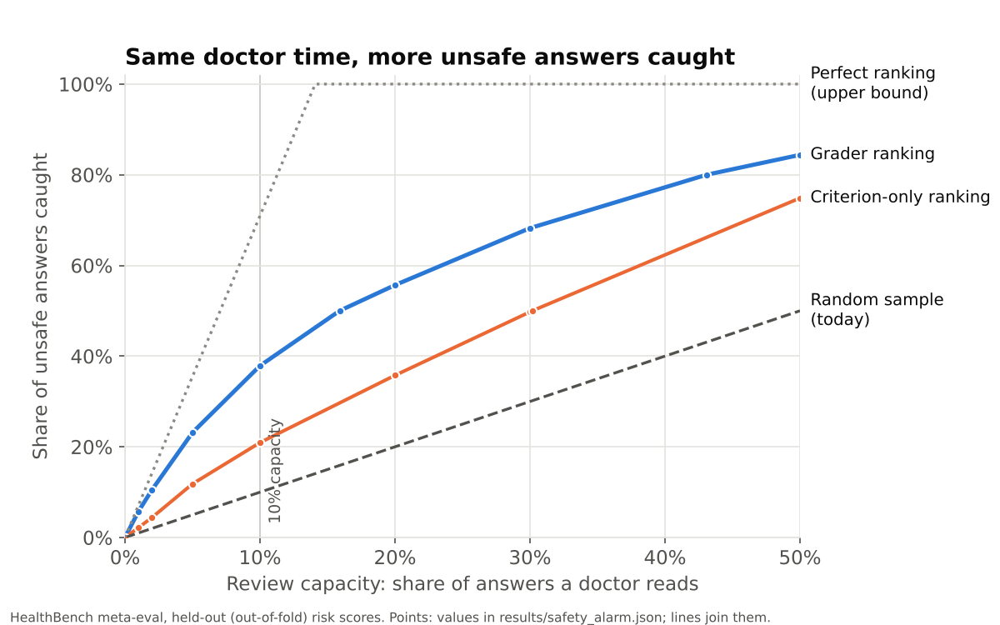

# Second Opinion

**A safety monitor for a health chatbot: it ranks the bot's answers by risk so that limited doctor time goes to the riskiest ones first, and it is measured against physicians.**

**[Try the live demo →](https://second-opinion-666.streamlit.app)**

**With the same doctor time, ranking by the grader catches about <!--n:ratio_10_grader_vs_random-->3.8<!--/n-->× as many unsafe answers as random sampling.** In detail: to catch half of the unsafe answers, doctors need to read <!--n:share_for_50_grader-->16%<!--/n--> of answers when the grader ranks them, against <!--n:share_for_50_random-->50%<!--/n--> with today's random sampling (<!--n:share_for_50_criterion_only-->30%<!--/n--> with a criterion-only ranking, <!--n:share_for_50_perfect-->7%<!--/n--> with a perfect one). At a capacity of 10% of answers, the grader ranking catches <!--n:recall_10_grader-->38%<!--/n--> of unsafe answers, against <!--n:recall_10_random-->10%<!--/n--> for random sampling, <!--n:recall_10_criterion_only-->21%<!--/n--> for criterion-only ranking and <!--n:recall_10_perfect-->71%<!--/n--> for perfect ranking.



*Generated by `scripts/make_figures.py` from `results/safety_alarm.json`; the plotted points are in `docs/figures/caught_vs_capacity.csv`. Held-out scores: every answer is ranked by a model that never saw its conversation.*

## The problem

A health chatbot answers patients' questions. Doctors cannot read every conversation, so a common
practice is to review a random sample. Most of that time is spent on answers that were fine. This
project asks three questions:

1. Can a cheap model grade answers the way physicians do, and how close does it get to how much
   physicians agree *with each other*?
2. Can its scores rank answers so that a fixed amount of doctor time catches more unsafe ones?
3. What does that cost per 1,000 answers, in doctor time and money?

It is a demonstration of an approach on public benchmark data, not a description of any
company's system.

## How it works

```
 every answer ──► quality grader ──► safety alarm ──► doctor review queue ──► feedback
                  (is it good?)       (is it risky?)    (ranked by risk,        becomes
                                                         sized by capacity)      training data
```

- **Data:** [HealthBench](https://openai.com/index/healthbench/) meta-eval (OpenAI, MIT licence):
  <!--n:data_answers-->14,592<!--/n--> model answers to <!--n:data_conversations-->3,671<!--/n--> benchmark conversations, each graded by
  several physicians against physician-written criteria. No real patient data.
- **Quality grader:** gradient-boosted trees on TF-IDF/SVD text features plus a few hand-built
  features; predicts whether physicians would say a criterion is met. Trained on soft labels
  (the share of physicians who said "met").
- **Safety alarm:** an answer is *unsafe* if a majority of physicians said it failed at least one of
  <!--n:n_safety_criteria-->12<!--/n--> safety criteria ([definitions](docs/labels.md)). Its risk score is the grader's highest held-out
  probability of "not met" on those criteria. Doctors review the top of the ranking, as far as
  capacity allows.
- **Baselines:** random sampling (today), a *criterion-only* model that knows which criterion is
  being checked but never reads the answer, and a perfect ranking (upper bound).
- **Feedback** is the loop's last step; turning doctor reviews into training examples is a next
  step, not built yet.

## Key results

Safety alarm (<!--n:answers_with_safety-->10,454<!--/n--> answers that have a safety criterion, of which <!--n:answers_unsafe-->1,473<!--/n--> or <!--n:share_unsafe-->14%<!--/n--> are unsafe;
held-out scores from grouped <!--n:alarm_folds-->5<!--/n-->-fold cross-validation):

<!--table:capacity-->
| Review capacity | Grader ranking | Criterion-only ranking | Random sample (today) | Perfect ranking (upper bound) |
|---|---|---|---|---|
| 1% | 6% | 2% | 1% | 7% |
| 2% | 11% | 4% | 2% | 14% |
| 5% | 23% | 12% | 5% | 36% |
| 10% | 38% | 21% | 10% | 71% |
| 20% | 56% | 36% | 20% | 100% |
| 30% | 68% | 50% | 30% | 100% |
| 50% | 84% | 75% | 50% | 100% |
<!--/table-->

Grader against physicians (C2 test split, <!--n:test_rows-->5,895<!--/n--> rows, 95% intervals resampled by conversation):

| | Grader | Criterion-only | Physicians |
|---|---|---|---|
| Balanced F1 (HealthBench metric) | <!--n:grader_f1-->0.687<!--/n--> (<!--n:grader_f1_ci-->0.673–0.702<!--/n-->) | <!--n:rubric_f1-->0.638<!--/n--> | <!--n:phys_f1_mean-->0.682<!--/n--> per physician, <!--n:phys_f1_pooled-->0.703<!--/n--> pooled |
| Cohen's kappa | <!--n:grader_kappa-->0.37<!--/n--> (<!--n:grader_kappa_ci-->0.35–0.40<!--/n-->) | <!--n:rubric_kappa-->0.28<!--/n--> | <!--n:phys_kappa-->0.41<!--/n--> |
| Ranking unsafe answers, ROC AUC | <!--n:auc_grader-->0.80<!--/n--> | <!--n:auc_criterion-->0.67<!--/n--> | – |

Cost at 10% capacity, per 1,000 screened answers, **using assumed figures** (<!--n:assume_minutes-->4<!--/n--> minutes per review,
EUR <!--n:assume_eur_per_hour-->90<!--/n--> per physician hour; not measured, adjustable in the demo): <!--n:cost10_reviews-->100<!--/n--> reviews,
<!--n:cost10_hours-->6.7<!--/n--> doctor hours, EUR <!--n:cost10_eur-->600<!--/n-->. That buys about <!--n:cost10_caught_grader-->53<!--/n--> unsafe answers caught with the grader ranking
against <!--n:cost10_caught_random-->14<!--/n--> with random sampling.

## Limitations

- **The grader misses about half of the failures.** Of the "not met" judgements physicians made,
  it agrees on <!--n:grader_recall_neg-->49%<!--/n--> (precision <!--n:grader_precision_neg-->54%<!--/n-->). It ranks well; it does not replace a doctor.
- **Physicians only moderately agree with each other** (kappa <!--n:phys_kappa-->0.41<!--/n-->), so "ground truth" is noisy.
  The grader is close to that level overall but below physicians on <!--n:n_criteria_below_phys-->28<!--/n--> of <!--n:n_criteria_compared-->33<!--/n--> criteria.
- **Contested answers are harder.** If answers where physicians split evenly also count as unsafe,
  ROC AUC drops from <!--n:auc_grader-->0.80<!--/n--> to <!--n:auc_grader_contested-->0.72<!--/n-->.
- **Two of seven themes are outside the alarm.** Hedging and complex-response answers
  (<!--n:answers_uncovered-->4,138<!--/n-->, <!--n:share_uncovered-->28%<!--/n--> of answers) have no safety criterion, so they can never be flagged.
- **Benchmark data, not real traffic.** The conversations were written for HealthBench; the unsafe
  rate and the gains may differ on a real chatbot. Cost figures are assumptions.

More in the [write-up](docs/WRITEUP.md) and the [model card](docs/MODEL_CARD.md).

## Reproduce

```bash
python -m venv .venv && source .venv/bin/activate
pip install -e ".[dev,docs]"
pytest                                  # unit tests; also checks docs against results
python scripts/download_data.py         # HealthBench files, SHA-256 verified
python scripts/explore_data.py          # C1: results/data_summary.json
python scripts/define_labels.py         # C1: results/label_summary.json
python scripts/train_grader.py          # C2/C3: results/grader_classical.json
python scripts/safety_alarm.py          # C4/C5: results/safety_alarm.json
python scripts/make_figures.py          # headline chart
python scripts/update_docs.py           # refill every number in the docs from results/
streamlit run app/streamlit_app.py      # the demo, from committed assets
```

Every number in this README, the write-up and the model card sits between markers that
`scripts/update_docs.py` fills from `results/*.json`; `tests/test_report.py` fails if a doc and the
results disagree, or if a doc contains an unmarked result-like number.

## Repo map

| Path | What it holds |
|---|---|
| `src/second_opinion/` | Library: data loading (`data.py`), labels (`labels.py`), grader (`grader.py`, `experiment.py`), physician-agreement metrics (`metrics.py`), safety alarm (`safety.py`), review budget and costs (`budget.py`), demo helpers (`demo.py`), doc numbers (`report.py`) |
| `scripts/` | One script per step above, plus `build_demo_assets.py` for the demo |
| `results/` | JSON results that every quoted number comes from |
| `app/` | Streamlit demo and its committed assets (model, precomputed scores, examples) |
| `docs/` | [Plan](docs/PLAN.md), [label definitions](docs/labels.md), [write-up](docs/WRITEUP.md), [model card](docs/MODEL_CARD.md), figures, screenshots |
| `tests/` | Unit tests, including the metric checked against OpenAI's reference code |

## About

Built by Edwin Richard Huwae: 9 years in project finance, now moving from data
analytics into machine learning for healthcare software.
